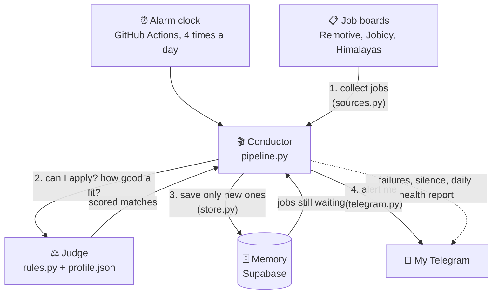

# Ajar 🚪

**In one sentence:** Ajar checks remote job boards for you, throws away the jobs you cannot
get through the door of, and sends the best of the rest to your Telegram.

## System Architecture Diagram



| Plain words | Industry term | Where |
|---|---|---|
| A translator for each job board | Adapter pattern | `sources.py` |
| Knock again, waiting longer each time | Exponential backoff with jitter | `http.py` |
| Stop knocking on a broken door for a while | Circuit breaker (within one run) | `http.py` |
| Never send the same job twice | Deduplication, idempotency | `models.py`, `store.py` |
| Hand the conductor its tools, so tests can hand it toys | Dependency injection | `pipeline.py`, `app.py` |
| A waiting line for unsent alerts | Outbox pattern, at-least-once delivery | `pipeline.py` |
| A diary a computer can read | Structured JSON logging | `logs.py` |
| "I'm alive" note once a day | Heartbeat | `pipeline.py` |

## How a job gets through

1. **Rejected** if: older than 14 days, undated or expired; senior title; restricted to a
   place that excludes Nigeria; contains a blocking phrase such as "US citizens only";
   asks for more than 4 years of experience; or the **title** matches none of your tracks.
2. **Scored** out of 100: title match 50, skills up to 30, open location 15 (EMEA 5),
   beginner friendly 10, fresh 5, minus 20 for 3+ years, minus 10 for far-off hours.
3. Scores of 60 or more are saved. Up to 10 are sent per run, best first. The rest wait.

Ajar reads text with fixed rules, so it can be wrong. Always read the advert yourself.
**Phase 1 does not check whether a job is a scam.** That is Phase 2. Never pay to apply,
and never send ID or bank details to a job you have not verified.

## Setup

You need the GitHub repository and these four **Actions secrets**
(Settings → Secrets and variables → Actions):

| Secret | What it is |
|---|---|
| `TELEGRAM_BOT_TOKEN` | The token @BotFather gave your Ajar bot |
| `TELEGRAM_CHAT_ID` | The number of the chat that receives alerts |
| `SUPABASE_URL` | `https://YOURPROJECT.supabase.co` |
| `SUPABASE_SERVICE_KEY` | The **secret** key (`sb_secret_…`) or legacy `service_role` key. Not the publishable/anon key |

1. Add the files to the repository, keeping the folders shown below.
2. In Supabase open **SQL Editor**, paste all of `schema.sql`, press **Run**.
3. In Telegram, open your Ajar bot and press **Start** (a bot cannot message you first).
4. In GitHub open **Actions → Ajar job search → Run workflow**, choose **doctor**.
   A green tick and a Telegram message mean all connections work.
5. Run it again and choose **run**. After that it runs by itself every 6 hours.

## Files

```
profile.json          what you are looking for (edit this, no code needed)
schema.sql            creates the database tables
requirements.txt      the one outside library
README.md  RUNBOOK.md  .env.example  .gitignore
ajar/                 __init__ app config errors http logs models pipeline rules sources store telegram
tests/                __init__ helpers test_rules test_http test_sources test_pipeline test_edges
.github/workflows/    ajar.yml (the schedule)   tests.yml (checks every change)
```

## Environment variables

The four secrets above, plus two optional **repository variables**:
`AJAR_PAUSED` (`true` switches Ajar off) and `LOG_LEVEL` (`DEBUG`, `INFO`, `WARN`, `ERROR`).

## Changing what it looks for

Edit `profile.json`. `titles` decides which jobs count, `skills` raises the score,
`min_score` makes it stricter or looser. Matching is on whole words.

## Tests

`pip install -r requirements.txt pytest` then `python -m pytest`. No network is used.

## Sources and fair use

Listings come from [Remotive](https://remotive.com), [Jobicy](https://jobicy.com) and
[Himalayas](https://himalayas.app). Every alert names and links its source. Ajar is for
personal use: do not repost these listings to other job boards. Each board's call limit
is enforced in code. Remotive delays its public listings by 24 hours.

When something breaks, see [RUNBOOK.md](RUNBOOK.md).
